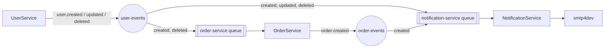
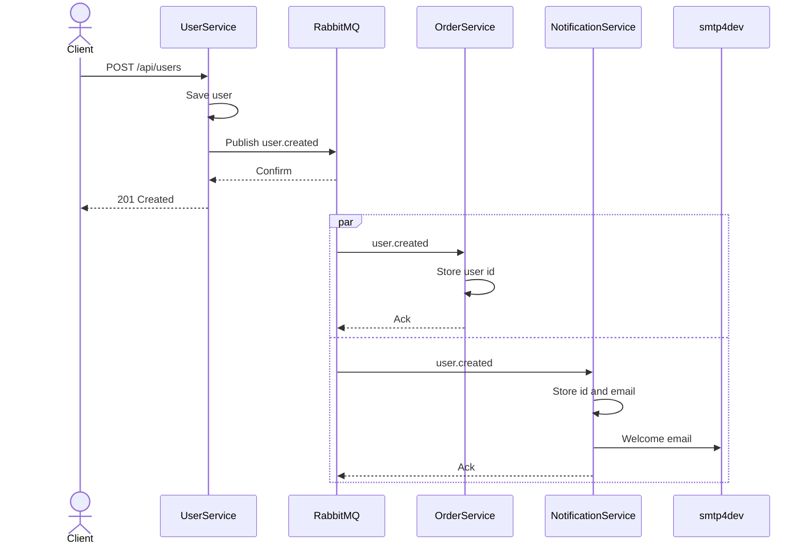
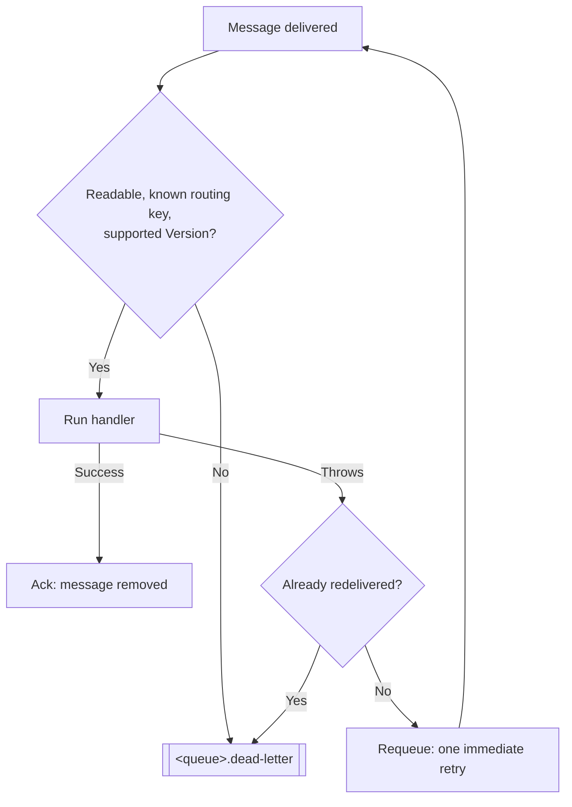

# Event-Driven Microservices Application

[](https://github.com/amir-magdy-of-wizardlabz/EventDrivenApp/actions/workflows/ci.yml)
[](https://dotnet.microsoft.com/download/dotnet/10.0)
[](LICENSE)

A small training example of an event-driven system: three .NET 10 services that never call each other and only communicate through events on RabbitMQ. Everything runs with one `docker compose up`.

It is small enough to read in an afternoon, and it is built to be broken on purpose: stop a service, stop the broker, send a bad message, and watch what happens.

## Contents

- [What You Will Learn](#what-you-will-learn)
- [Quick Start](#quick-start)
- [Architecture](#architecture)
- [Guided Tour](#guided-tour)
- [HTTP API](#http-api)
- [Events](#events)
- [Messaging Design](#messaging-design)
- [Project Layout](#project-layout)
- [Adding a New Event](#adding-a-new-event)
- [Configuration](#configuration)
- [Running a Service Outside Docker](#running-a-service-outside-docker)
- [Tests](#tests)
- [Troubleshooting](#troubleshooting)
- [Known Limitations and Exercises](#known-limitations-and-exercises)

## What You Will Learn

| Concept | Where to see it |
| --- | --- |
| Services that share no database and make no calls to each other | `docker-compose.yml`: one database per service, no service URL configured anywhere |
| Keeping a local copy of another service's data | OrderService and NotificationService each have their own `Users` table, filled from events |
| Eventual consistency | An order placed right after creating a user can be rejected with `422` |
| Publisher confirms and persistent messages | `SharedMessaging/RabbitMqEventPublisher.cs` |
| Manual acknowledgement, retry and dead-lettering | `SharedMessaging/RabbitMqConsumer.cs` |
| Idempotent handlers for at-least-once delivery | Every class in `*/Infrastructure/Messaging` |
| Event contracts and versioning | `SharedEvents/Events` and `SharedEvents/Topology.cs` |
| The dual-write problem | `UserService.Core/Services/UserService.cs`, and the first exercise at the end of this page |

## Quick Start

You need Docker. The .NET 10 SDK is only needed to run the tests or a service outside Docker.

```sh
docker compose up --build
```

Wait until the three services log `Consuming from queue ...` or `Now listening on ...`, then:

```sh
# 1. Create a user -> a welcome email appears in smtp4dev
curl -X POST http://localhost:5001/api/users \
  -H "Content-Type: application/json" \
  -d '{"name": "John Doe", "email": "johndoe@example.com"}'

# 2. Create an order for that user -> an order confirmation email appears
curl -X POST http://localhost:5002/api/orders \
  -H "Content-Type: application/json" \
  -d '{"userId": 1, "productName": "Laptop", "quantity": 1, "price": 1500.00}'
```

Open the inbox at http://localhost:3000 to see both emails.

| What | URL |
| --- | --- |
| UserService Swagger | http://localhost:5001/swagger |
| OrderService Swagger | http://localhost:5002/swagger |
| Health checks | http://localhost:5001/health, `:5002/health`, `:5003/health` |
| RabbitMQ management (`ruser` / `pass123~`) | http://localhost:15672 |
| smtp4dev inbox | http://localhost:3000 |

Data is kept in the `db-data` and `rabbitmq-data` volumes. To start again from nothing:

```sh
docker compose down -v
```

The credentials in `docker-compose.yml` are throwaway values for this sample. Do not reuse them anywhere real.

## Architecture

| Service | Role | Owns | Port |
| --- | --- | --- | --- |
| **UserService** | CRUD API for users. Publishes `user.created`, `user.updated`, `user.deleted`. | `event-driven-user-service` database | 5001 |
| **OrderService** | CRUD API for orders. Keeps a local copy of user ids so it can validate orders without calling UserService. Publishes `order.created`. | `event-driven-order-service` database | 5002 |
| **NotificationService** | No API. Keeps a local copy of user email addresses and sends the welcome and order confirmation emails. | `event-driven-notification-service` database | 5003 (health only) |



Supporting containers: PostgreSQL (one server, one database per service), RabbitMQ with the management UI, and smtp4dev as a fake mail server.

### What happens for each event

| Event | OrderService | NotificationService |
| --- | --- | --- |
| `user.created` | Stores the user id | Stores the id and email, sends the welcome email |
| `user.updated` | Not subscribed (it only keeps ids) | Updates the stored email |
| `user.deleted` | Deletes the user and, through the foreign key, their orders | Deletes the stored user |
| `order.created` | Publisher | Sends the order confirmation to the stored email |

### Creating a user, step by step



The client gets its `201` as soon as the broker has the message. The two consumers do their work afterwards, each at its own pace, and neither knows the other exists.

### What happens when a handler fails



## Guided Tour

Each of these takes a minute and shows one property of the system. Run them with the stack up.

1. **A service can be down without losing work.**
   `docker compose stop notificationserviceapi`, create a user, then `docker compose start notificationserviceapi`. The event waited in the `notification-service` queue and the welcome email arrives late. The services are decoupled in time.

2. **Each service only knows what it has been told.**
   Create an order for user id `999`. OrderService answers `422`, because it has never received a `user.created` for that id. It does not ask UserService.

3. **Deleting travels too.**
   Create a user and an order, then `DELETE /api/users/{id}`. A moment later `GET http://localhost:5002/api/orders` no longer lists that user's orders: OrderService handled `user.deleted` and the foreign key removed them.

4. **A bad message does not block the queue.**
   In the RabbitMQ management UI open **Queues → order-service → Publish message**, set the payload to `not json` and publish. The message moves to `order-service.dead-letter`, the service logs an error, and it keeps handling the messages behind it.

5. **An unsupported version is refused.**
   Publish to the `user-events` exchange with routing key `user.created` and payload `{"Id": 50, "Email": "a@b.c", "Name": "A", "Version": "2.0"}`. Both consumers dead-letter it instead of guessing what version 2.0 means.

6. **Messages survive a broker restart.**
   Stop NotificationService, create a user, `docker compose restart rabbitmq`, then start NotificationService. The email still arrives, because the queue is durable and the message was published as persistent.

7. **The weak spot.**
   `docker compose stop rabbitmq`, then create a user. The request fails with `500`, **but the user is saved**, and no other service will ever hear about it. This is the dual-write problem; fixing it is the first exercise at the end of this page.

The happy-path requests, plus update and delete, are also in `UserService.Api/HttpTests` and `OrderService.Api/HttpTests` for the VS Code REST Client or the JetBrains HTTP client.

## HTTP API

Request and response bodies are JSON with camelCase names. A body that fails validation gets `400` with a problem-details document listing the invalid fields.

### UserService (`http://localhost:5001`)

| Method and path | Body | Success | Other responses |
| --- | --- | --- | --- |
| `GET /api/users` | | `200` with the list | |
| `GET /api/users/{id}` | | `200` with the user | `404` unknown id |
| `POST /api/users` | `name` (required, max 100), `email` (required, valid address) | `201` with the user and a `Location` header | `409` email already used |
| `PUT /api/users/{id}` | Same as `POST` | `204` | `404` unknown id, `409` email already used |
| `DELETE /api/users/{id}` | | `204` | `404` unknown id |

### OrderService (`http://localhost:5002`)

| Method and path | Body | Success | Other responses |
| --- | --- | --- | --- |
| `GET /api/orders` | | `200` with the list | |
| `GET /api/orders/{id}` | | `200` with the order | `404` unknown id |
| `POST /api/orders` | `userId` (1 or more), `productName` (required, max 200), `quantity` (1 or more), `price` (0 or more) | `201` with the order and a `Location` header | `422` user not known to OrderService |
| `PUT /api/orders/{id}` | `productName`, `quantity`, `price` | `204` | `404` unknown id |
| `DELETE /api/orders/{id}` | | `204` | `404` unknown id |

Ids and the order date are set by the server, and an order cannot be moved to another user. Only `POST /api/orders` publishes an event; updating or deleting an order does not.

## Events

All events derive from `EventBase`, which carries a `Version`. The message body is JSON with the property names exactly as they are in the C# classes.

| Routing key | Exchange | Class | Payload |
| --- | --- | --- | --- |
| `user.created` | `user-events` | `UserCreatedEvent` | `Id`, `Name`, `Email`, `Version` |
| `user.updated` | `user-events` | `UserUpdatedEvent` | `Id`, `Name`, `Email`, `Version` |
| `user.deleted` | `user-events` | `UserDeletedEvent` | `Id`, `Version` |
| `order.created` | `order-events` | `OrderCreatedEvent` | `OrderId`, `UserId`, `TotalAmount`, `OrderDate`, `Version` |

Example body of `user.created`:

```json
{ "Id": 1, "Email": "johndoe@example.com", "Name": "John Doe", "Version": "1.0" }
```

Every message is also published with these AMQP properties, which you can see in the management UI with **Get messages**:

| Property | Value |
| --- | --- |
| `delivery_mode` | `2` (persistent) |
| `content_type` | `application/json` |
| `message_id` | A new GUID per publish; it appears in the consumer's error logs |
| `type` | The event class name, for example `UserCreatedEvent` |
| `timestamp` | When it was published (UTC) |

**Versioning.** Each event class decides which versions it accepts in `IsValidVersion()`; today that is only `1.0`. A consumer dead-letters anything else, so an incompatible change is noticed instead of being half-understood.

## Messaging Design

The RabbitMQ code lives in `SharedMessaging` and is the same for every service.

- **Topology.** One durable direct exchange per publishing service (`user-events`, `order-events`). Each consuming service declares one durable queue named after itself and binds it to the routing keys it wants. Publishers never declare queues: who listens is the listener's business. Exchange names and routing keys are constants in `SharedEvents/Topology.cs`, because they are part of the contract.
- **One queue per service**, not per event type, so a user's `created`, `updated` and `deleted` events are handled in the order they were published.
- **Publishing.** Messages are persistent and the publisher waits up to 5 seconds for the broker's confirm, so `Publish` returning means the broker has the message, and a broker that cannot take it makes `Publish` throw. The connection is shared for the life of the process; each publish uses its own channel, because channels are not thread-safe.
- **Consuming.** Manual acknowledgement with a prefetch of 10. A message is acknowledged only after its handler has finished. Each message gets its own dependency injection scope, so a handler can use a `DbContext` like a controller does.
- **Failures.** A handler that throws gets one immediate retry. If it fails again, or the message cannot be read or has an unsupported `Version`, it is moved to `<queue>.dead-letter`. Nothing is dropped silently and one bad message cannot block the queue or crash the service. Dead-lettered messages stay there until someone looks at them in the management UI.
- **Idempotency.** Delivery is at-least-once, so the same event can arrive twice. Every handler checks current state first and is safe to run again. The one visible effect of a redelivery is that an email can be sent twice.
- **Startup.** A consumer that cannot reach RabbitMQ retries every 5 seconds instead of stopping the service. After that the client library reconnects on its own.

What you should see in the management UI once all three services are up:

| Kind | Name | Notes |
| --- | --- | --- |
| Exchange | `user-events`, `order-events` | Direct, durable |
| Queue | `order-service` | Bound to `user.created`, `user.deleted` |
| Queue | `notification-service` | Bound to `user.created`, `user.updated`, `user.deleted`, `order.created` |
| Queue | `order-service.dead-letter`, `notification-service.dead-letter` | Should be empty; anything here is a message that could not be handled |

## Project Layout

```
SharedEvents/             Event contracts, exchange and routing key names, IEventPublisher, IEventHandler
SharedMessaging/          RabbitMQ implementation: connection, publisher, consumer with retry and dead-lettering
<Service>.Api/            HTTP endpoints, request models, Program.cs, Dockerfile
<Service>.Core/           Entities, repository interfaces, business logic. No infrastructure dependencies
<Service>.Infrastructure/ EF Core context and migrations, repositories, event handlers
tests/                    Unit tests per service and integration tests against real RabbitMQ and PostgreSQL
```

Good files to read first, in this order:

1. `SharedEvents/Topology.cs` and `SharedEvents/Events`: the whole contract between the services.
2. `UserService.Core/Services/UserService.cs`: save, then publish.
3. `NotificationService.Infrastructure/Extensions/ServiceCollectionExtensions.cs`: how a service says which events it wants.
4. `NotificationService.Infrastructure/Messaging/UserCreatedEventHandler.cs`: an idempotent handler.
5. `SharedMessaging/RabbitMqConsumer.cs`: acknowledgement, retry and dead-lettering in about 140 lines.

Each service applies its own EF Core migrations when it starts.

## Adding a New Event

Say OrderService should publish `order.deleted` and NotificationService should send an email for it.

1. **Contract.** Add `OrderDeletedEvent : EventBase` to `SharedEvents/Events`, and a `RoutingKeys.OrderDeleted = "order.deleted"` constant to `SharedEvents/Topology.cs`.
2. **Publish.** In `OrderService.Core/Services/OrderService.cs`, after the delete is saved:

   ```csharp
   _eventPublisher.Publish(Exchanges.Orders, RoutingKeys.OrderDeleted,
       new OrderDeletedEvent { OrderId = id, UserId = order.UserId, Version = "1.0" });
   ```

3. **Handle.** Add a class in `NotificationService.Infrastructure/Messaging` that implements `IEventHandler<OrderDeletedEvent>`. Make it safe to run twice.
4. **Subscribe.** Add one line to the consumer registration in `NotificationService.Infrastructure/Extensions/ServiceCollectionExtensions.cs`:

   ```csharp
   .Subscribe<OrderDeletedEvent, OrderDeletedEventHandler>(Exchanges.Orders, RoutingKeys.OrderDeleted)
   ```

5. **Test.** Add a unit test for the publisher in `tests/OrderService.Tests` and one for the handler in `tests/NotificationService.Tests`.

No RabbitMQ setup is needed: the binding is created when NotificationService next starts.

## Configuration

Settings come from `appsettings.Development.json` when a service runs on your machine and from environment variables in `docker-compose.yml` when it runs in Docker (`RabbitMQ__HostName` is the environment variable form of `RabbitMQ:HostName`).

| Setting | Used by | Default | Meaning |
| --- | --- | --- | --- |
| `ConnectionStrings:DefaultConnection` | All | None, required | PostgreSQL connection string for that service's own database |
| `RabbitMQ:HostName` | All | None, required | Broker host |
| `RabbitMQ:Port` | All | `5672` | Broker port |
| `RabbitMQ:UserName`, `RabbitMQ:Password` | All | None, required | Broker credentials |
| `Smtp:Host` | NotificationService | None, required | Mail server host |
| `Smtp:Port` | NotificationService | `25` | Mail server port |
| `Smtp:FromAddress` | NotificationService | `admin@emailserver.com` | Sender address |
| `ASPNETCORE_ENVIRONMENT` | All | `Production` | Swagger is only served when this is `Development`, which Compose sets |

Ports published by Compose. The infrastructure ports are bound to `127.0.0.1` so they are not reachable from the network.

| Port | Container |
| --- | --- |
| 5001, 5002, 5003 | UserService, OrderService, NotificationService |
| 5432 | PostgreSQL |
| 5672, 15672 | RabbitMQ (AMQP, management UI) |
| 3000, 2525 | smtp4dev (inbox UI, SMTP) |

## Running a Service Outside Docker

Start only the infrastructure, then run a service from your IDE or with `dotnet run`. The `appsettings.Development.json` files point at `localhost`.

```sh
docker compose up db rabbitmq smtp4dev
dotnet run --project UserService.Api
```

To add a migration (example for UserService):

```sh
dotnet tool install --global dotnet-ef   # once
dotnet ef migrations add <Name> --project UserService.Infrastructure --startup-project UserService.Api
```

The migration is applied the next time the service starts.

## Tests

```sh
dotnet test
```

| Project | Tests | What it covers | Needs Docker |
| --- | --- | --- | --- |
| `tests/UserService.Tests` | 10 | Business rules, which events are published, and the HTTP status codes, using in-memory fakes | No |
| `tests/OrderService.Tests` | 13 | The same for orders, plus the `user.created` and `user.deleted` handlers | No |
| `tests/NotificationService.Tests` | 8 | Event handlers: what is stored, what is emailed, and that handling an event twice is safe | No |
| `tests/IntegrationTests` | 9 | The real publisher and consumer against RabbitMQ (delivery, retry, dead-lettering, bad JSON, unsupported version), and the migrations, unique email constraint and cascade delete against PostgreSQL | Yes |

The integration tests start their own containers with [Testcontainers](https://dotnet.testcontainers.org/), so they do not need the Compose stack and do not touch its data. To run one project, for example one that needs no Docker:

```sh
dotnet test --project tests/UserService.Tests
```

The tests use xUnit v3 on Microsoft.Testing.Platform, which is switched on in `global.json`. That file also pins the SDK to 10.0.x.

**CI.** `.github/workflows/ci.yml` runs on every pull request and on every push to `main`. It builds with warnings treated as errors, runs all the tests, and builds the three Docker images.

## Troubleshooting

| Symptom | Cause and fix |
| --- | --- |
| `Cannot load library libgssapi_krb5.so.2` in a service log | Harmless. The PostgreSQL driver looks for Kerberos support, which the image does not have and this sample does not use. |
| A failed query on `__EFMigrationsHistory` the first time a service starts | Harmless. EF Core checks for its history table before creating it. |
| `RabbitMQ is unreachable ...; retrying in 00:00:05` | The broker is not up yet. The consumer keeps retrying and logs `Consuming from queue ...` once it connects. |
| `POST /api/orders` returns `422` for a user you just created | OrderService has not handled `user.created` yet. Try again, and see [Known Limitations](#known-limitations-and-exercises). |
| A message sits in a `.dead-letter` queue | Its handler failed twice, or it was unreadable. The service log has the reason next to the same message id. |
| No email in smtp4dev | Look at the NotificationService log and at `notification-service.dead-letter`. An `order.created` for a user NotificationService does not know is dead-lettered. |
| `/swagger` returns `404` | The service is not running with `ASPNETCORE_ENVIRONMENT=Development`. |
| A port is already in use | Something else on your machine uses 5432, 5672, 15672, 3000 or 5001 to 5003. Stop it or change the left-hand port in `docker-compose.yml`. |
| Strange state after changing the schema or topology | `docker compose down -v` removes both volumes and starts clean. |

## Known Limitations and Exercises

These are deliberate simplifications. Each one is a good exercise, roughly in order of how much it teaches.

1. **No transactional outbox.** A service saves to its database and then publishes. If the publish fails, the row exists but the event was never sent, and the other services never find out (step 7 of the guided tour). *Exercise:* write the event to an outbox table in the same transaction as the entity, and publish it from a background worker.
2. **No replay for dead-lettered messages.** They have to be moved back by hand, for example with the shovel plugin. *Exercise:* add an endpoint or a small tool that republishes them.
3. **The retry is immediate.** A dependency that is down for ten seconds fails both attempts. *Exercise:* add delayed retries with a TTL queue that dead-letters back into the main queue.
4. **Emails can be sent twice** when a message is redelivered. *Exercise:* store the ids of handled messages and skip the ones already seen.
5. **Eventual consistency is visible.** An order placed immediately after creating a user can get a `422` if OrderService has not processed `user.created` yet. *Exercise:* decide what the client should do, and whether the API should say "try again" differently from "this user does not exist".
6. **`TotalAmount` in `order.created` is the order's `Price`**, not price times quantity, and the order model does not say whether `Price` is per unit. *Exercise:* make the model unambiguous, then change the event without breaking a consumer that still expects version `1.0`.
7. **Order updates and deletes publish nothing.** *Exercise:* follow [Adding a New Event](#adding-a-new-event).
8. **No authentication** on the APIs.
9. **RabbitMQ.Client 6.** Version 7 has a fully asynchronous API; here publishing blocks briefly while it waits for the broker's confirm.
10. **`System.Net.Mail.SmtpClient`** is used to avoid a dependency. Microsoft recommends MailKit for new code.

## License

[MIT](LICENSE)
