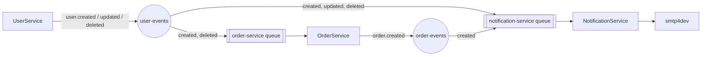

# Event-Driven Microservices Application

A small training example of an event-driven system: three .NET 8 services that never call each other and only communicate through events on RabbitMQ. Everything runs with Docker Compose.

## Overview

| Service | Role | Owns | Port |
| --- | --- | --- | --- |
| **UserService** | CRUD API for users. Publishes `user.created`, `user.updated`, `user.deleted`. | `event-driven-user-service` database | 5001 |
| **OrderService** | CRUD API for orders. Keeps a local copy of user ids so it can validate orders without calling UserService. Publishes `order.created`. | `event-driven-order-service` database | 5002 |
| **NotificationService** | No API. Keeps a local copy of user email addresses and sends the welcome and order confirmation emails. | `event-driven-notification-service` database | 5003 (health only) |



Supporting containers: PostgreSQL (one server, one database per service), RabbitMQ with the management UI, and smtp4dev as a fake mail server.

### What happens for each event

| Event | OrderService | NotificationService |
| --- | --- | --- |
| `user.created` | Stores the user id | Stores the id and email, sends the welcome email |
| `user.updated` | Not subscribed (it only keeps ids) | Updates the stored email |
| `user.deleted` | Deletes the user and, through the foreign key, their orders | Deletes the stored user |
| `order.created` | Publisher | Sends the order confirmation to the stored email |

## Running the Application

```sh
docker compose up --build
```

| What | URL |
| --- | --- |
| UserService Swagger | http://localhost:5001/swagger |
| OrderService Swagger | http://localhost:5002/swagger |
| Health checks | http://localhost:5001/health, `:5002/health`, `:5003/health` |
| RabbitMQ management (`ruser` / `pass123~`) | http://localhost:15672 |
| smtp4dev inbox | http://localhost:3000 |

Data is kept in the `db-data` and `rabbitmq-data` volumes. To start again from nothing:

```sh
docker compose down -v
```

The credentials in `docker-compose.yml` are throwaway values for this sample. Do not reuse them anywhere real.

## Trying It Out

```sh
# 1. Create a user -> welcome email appears in smtp4dev
curl -X POST http://localhost:5001/api/users \
  -H "Content-Type: application/json" \
  -d '{"name": "John Doe", "email": "johndoe@example.com"}'

# 2. Create an order for that user -> order confirmation email appears
curl -X POST http://localhost:5002/api/orders \
  -H "Content-Type: application/json" \
  -d '{"userId": 1, "productName": "Laptop", "quantity": 1, "price": 1500.00}'
```

The same requests, plus update and delete, are in `UserService.Api/HttpTests` and `OrderService.Api/HttpTests` for the VS Code REST Client or the JetBrains HTTP client.

Things worth trying, because they show how the system behaves when it is not the happy path:

- Order for a user id that does not exist: `422`, because OrderService has never received that user.
- Create the same email twice: `409`.
- `docker compose stop notificationserviceapi`, create a user, start it again: the event waited in the queue and the email is sent late. The services are decoupled in time.
- `docker compose stop rabbitmq`, then create a user: the request fails with `500` **but the user is saved**. See the limitations below.

## Messaging Design

The RabbitMQ code lives in `SharedMessaging` and is the same for every service.

- **Topology.** One durable direct exchange per publishing service (`user-events`, `order-events`). Each consuming service declares one durable queue named after itself and binds it to the routing keys it wants. Publishers never declare queues: who listens is the listener's business. Exchange names and routing keys are constants in `SharedEvents/Topology.cs`, because they are part of the contract.
- **One queue per service**, not per event type, so a user's `created`, `updated` and `deleted` events are handled in the order they were published.
- **Publishing.** Messages are persistent and the publisher waits for the broker's confirm, so `Publish` returning means the broker has the message. The connection is shared for the life of the process; each publish uses its own channel.
- **Consuming.** Manual acknowledgement with a prefetch of 10. A message is acknowledged only after its handler has finished.
- **Failures.** A handler that throws gets one immediate retry. If it fails again, or the message cannot be read or has an unsupported `Version`, it is moved to `<queue>.dead-letter`. Nothing is dropped silently and one bad message cannot block the queue or crash the service. Dead-lettered messages stay there until someone looks at them in the management UI.
- **Idempotency.** Delivery is at-least-once, so the same event can arrive twice. Every handler checks current state first and is safe to run again. The one visible effect of a redelivery is that an email can be sent twice.
- **Startup.** A consumer that cannot reach RabbitMQ retries every 5 seconds instead of stopping the service. After that the client library reconnects on its own.

## Project Layout

```
SharedEvents/            Event contracts, exchange and routing key names, IEventPublisher, IEventHandler
SharedMessaging/         RabbitMQ implementation: connection, publisher, consumer with retry and dead-lettering
<Service>.Api/           HTTP endpoints, request models, Program.cs, Dockerfile
<Service>.Core/          Entities, repository interfaces, business logic. No infrastructure dependencies
<Service>.Infrastructure/ EF Core context and migrations, repositories, event handlers
```

Each service applies its own EF Core migrations when it starts.

## Running a Service Outside Docker

Start only the infrastructure, then run a service from your IDE or with `dotnet run`. The `appsettings.Development.json` files point at `localhost`.

```sh
docker compose up db rabbitmq smtp4dev
dotnet run --project UserService.Api
```

To add a migration (example for UserService):

```sh
dotnet ef migrations add <Name> --project UserService.Infrastructure --startup-project UserService.Api
```

## Known Limitations

These are deliberate simplifications. Each one is a good exercise.

- **No transactional outbox.** A service saves to its database and then publishes. If the publish fails, the row exists but the event was never sent, and the other services never find out. The fix is to write the event to an outbox table in the same transaction and publish it from a background worker.
- **No replay for dead-lettered messages.** They have to be moved back by hand, for example with the shovel plugin.
- **Eventual consistency is visible.** An order placed immediately after creating a user can get a `422` if OrderService has not processed `user.created` yet.
- **No authentication** on the APIs, and **no automated tests**.
- **`System.Net.Mail.SmtpClient`** is used to avoid a dependency. Microsoft recommends MailKit for new code.
